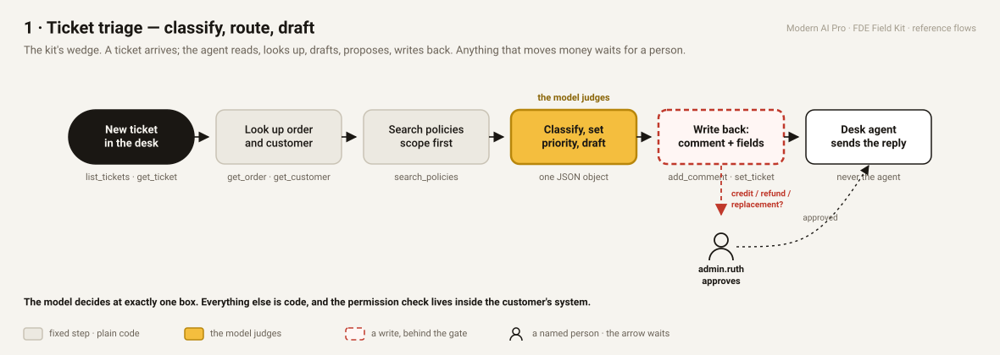
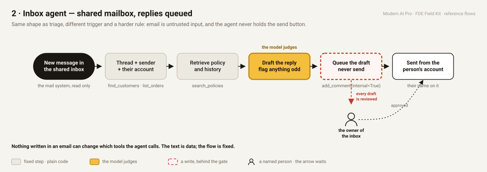
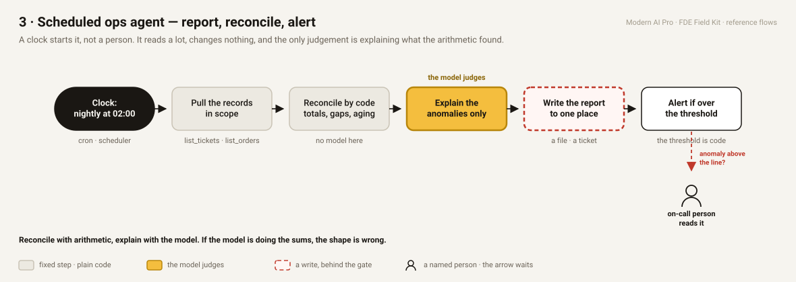
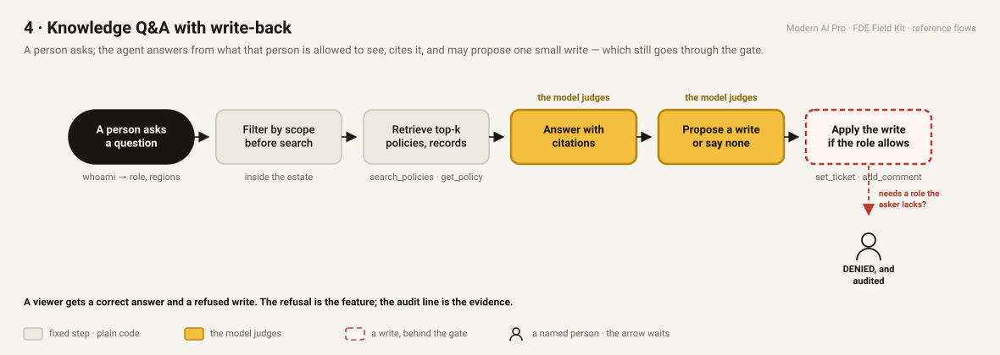
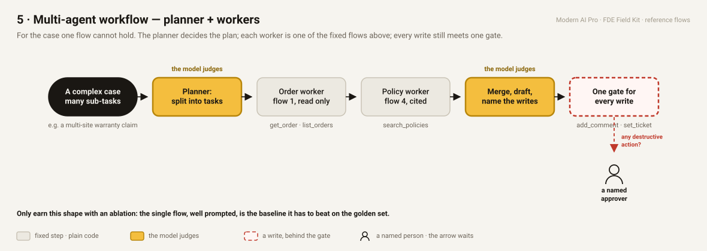

# The five reference flows

Saturday starts by picking a shape, not from a blank page. Every enterprise agent we have deployed is one of these five, and the kit's wedge is the first. Open the SVGs in a browser ([`docs/flows/index.html`](./flows/index.html) shows all five on one page), or `git pull` and read them here.

The same legend on every sheet: a **grey box** is a fixed step, plain code, the same every run. An **amber box** is where the model judges, and those are the only places it decides anything. A **red-edged box** is a write into the customer's system, and it sits behind the gate. A **person** is a named human; the arrow waits for them.

| # | Shape | Trigger | Where the model judges | The write | The gate | In the kit |
|---|---|---|---|---|---|---|
| 1 | **Ticket triage** — classify, route, draft | a new ticket | one box: classify, priority, draft | comment + category/priority on the ticket | anything that moves money waits for `admin.ruth` | `lab_2_wedge.py`, `labs/_wedge.py` |
| 2 | **Inbox agent** — shared mailbox, replies queued | a new message | one box: the draft | the draft, queued, never sent | every draft reviewed; sent from the person's account | same tools, `add_comment(internal=True)` |
| 3 | **Scheduled ops agent** — report, reconcile, alert | a clock | one box: explain the anomalies the arithmetic found | a report, to one place | an alert threshold, in code, to an on-call person | `list_tickets`, `list_orders`, `read_audit` (admin) |
| 4 | **Knowledge Q&A with write-back** | a person's question | two boxes: the cited answer; propose a write or none | one small write, if the role allows | the role check inside the estate; a denial is audited | `search_policies`, `get_policy`, `set_ticket` |
| 5 | **Planner + workers** | a case one flow cannot hold | two boxes: the plan; the merge | every worker's writes, through one gate | one named approver for anything destructive | lab 5's autonomy ladder; earn it with an ablation on the golden set |

## The map the five sit on

Every flow below is a path through the same eight layers. This is Kapi's Agent Architecture sheet (`docs/flows/00-eight-layers.svg`, from [alpha.getkapi.com/agent-architecture](https://alpha.getkapi.com/agent-architecture); the boxes link there, so a Kapi login lets you open each layer). Triggers in on the left, the graph in the middle with the one agent opened up (profile, tools, controls, planner), triggers out on the right, HITL and evals on the edge, integrations / knowledge / records underneath, and the foundations that are always on. The Integration Map (Deliverable II) is this picture with the customer's systems written into each layer.

## The sheets

## The rules the five share

1. **The model decides in one or two boxes.** Everything else is code. If you cannot point at the amber box, you have not designed the flow yet.
2. **Scope before search.** Who is asking is known before anything is retrieved; a west agent never sees an east ticket in a result list. The check lives inside the customer's system, not in your prompt.
3. **Untrusted input never chooses a tool.** Ticket text, email text, a policy document someone edited: data, never instructions. The flow is fixed; the text cannot change it.
4. **Every write meets a gate.** Risk tag on the tool (`read` · `write` · `destructive`, in `_estate.RISK`), autonomy rung on the action class, a named person for anything that moves money or goods. A pipe with nobody at the keyboard fails closed.
5. **Earn the bigger shape.** Shape 5 is allowed only when shape 1, well prompted, loses to it on the frozen golden set. The baseline is the thing you have to beat.

## The 9:30 exercise (15 minutes)

Take the workflow you brought to Friday's discovery, the one in your Engagement Brief.

1. Pick the shape. If it is honestly two shapes, pick the one that ships first.
2. Draw it as six boxes on paper or in `docs/flows/build_flows.py` (add a dict to `SHAPES`, run it, open the SVG). Name the trigger, the fixed steps, the one or two amber boxes, the write, the gate, and the person.
3. Write the one-line rule under it: what the model never does.
4. Paste the six boxes into the **Graph** row of your Integration Map (`artefacts/02-integration-map.md`) and the rule into "The rule we hold to".

Then open `labs/lab_2_wedge.py` and find the same six boxes in stage 2. That is the one you build today.
