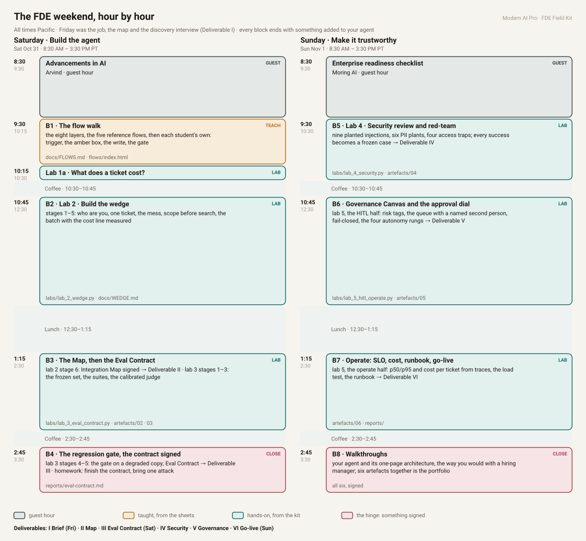

# The weekend, hour by hour

All times Pacific. Friday was the job, the map and the discovery interview (Deliverable I). Every block below ends with something added to your agent, and the four hinge blocks end with something signed.

## Saturday · Build the agent

| Time | Block | What happens | Files |
|---|---|---|---|
| 8:30–9:30 | Guest hour | Advancements in AI, Arvind | |
| 9:30–10:15 | B1 · The flow walk | the eight layers, the five reference flows, then each student's own: trigger, the amber box, the write, the gate | `docs/FLOWS.md`, `docs/flows/index.html` |
| 10:15–10:30 | Lab 1a · What does a ticket cost? | four lines on paper, then the calculator; prices from your provider's page | `labs/lab_1a_cost.py`, `docs/COST.md` |
| 10:30–10:45 | Coffee | | |
| 10:45–12:30 | B2 · Lab 2 · Build the wedge | stages 1–5: who are you, one ticket, the mess, scope before search, the batch with the cost line measured | `labs/lab_2_wedge.py`, `docs/WEDGE.md` |
| 12:30–1:15 | Lunch | | |
| 1:15–2:30 | B3 · The Map, then the Eval Contract | lab 2 stage 6: Integration Map signed → **Deliverable II** · lab 3 stages 1–3: the frozen set, the suites, the calibrated judge | `labs/lab_3_eval_contract.py`, `artefacts/02`, `artefacts/03` |
| 2:30–2:45 | Coffee | | |
| 2:45–3:30 | B4 · The regression gate, the contract signed | lab 3 stages 4–5: the gate on a degraded copy; Eval Contract → **Deliverable III**. Homework: finish the contract, bring one attack for Sunday | `reports/eval-contract.md` |

## Sunday · Make it trustworthy

| Time | Block | What happens | Files |
|---|---|---|---|
| 8:30–9:30 | Guest hour | Enterprise readiness checklist, Moring AI | |
| 9:30–10:30 | B5 · Lab 4 · Security review and red-team | nine planted injections, six PII plants, four access traps; every success becomes a frozen case → **Deliverable IV** | `labs/lab_4_security.py`, `artefacts/04` |
| 10:30–10:45 | Coffee | | |
| 10:45–12:30 | B6 · Governance Canvas and the approval dial | lab 5, the HITL half: risk tags, the queue with a named second person, fail-closed, the four autonomy rungs → **Deliverable V** | `labs/lab_5_hitl_operate.py`, `artefacts/05` |
| 12:30–1:15 | Lunch | | |
| 1:15–2:30 | B7 · Operate: SLO, cost, runbook, go-live | lab 5, the operate half: p50/p95 and cost per ticket from traces, the load test, the runbook → **Deliverable VI** | `artefacts/06`, `reports/` |
| 2:30–2:45 | Coffee | | |
| 2:45–3:30 | B8 · Walkthroughs | your agent and its one-page architecture, the way you would with a hiring manager; six artefacts together is the portfolio | all six, signed |

The sheet is generated by `docs/schedule/build_schedule.py`; edit `DAYS` there and re-run. The same SVG is served at [study.modernaipro.com/guides/fde-weekend.svg](https://study.modernaipro.com/guides/fde-weekend.svg).
