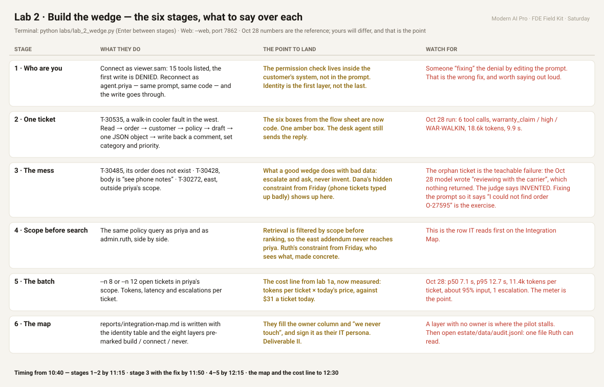

# Lab 2 · Build the wedge — the walkthrough

**In one sentence:** by lunch every student has run one ticket through the customer's own system as a named user, seen the customer's permission check refuse them, watched the agent fail honestly on broken data, and has a number for cost and latency per ticket. That is the Integration Map, Deliverable II, with evidence behind every row.

The lab is the walkthrough. `python labs/lab_2_wedge.py` runs the six stages in order and stops before each one with "Enter to run · s skip · q quit", so the room moves together and everyone sees the same ticket, because the showcase tickets are fixed in the file. `--web` gives the same six stages as panels with the knobs on port 7862, which suits the business track. Every call, allowed or denied, lands in `estate/data/audit.jsonl`.

| Stage | What they do | The point to land | Watch for |
|---|---|---|---|
| 1 Who are you | Connect as `viewer.sam`: 15 tools listed, first write DENIED. Reconnect as `agent.priya`, same prompt, same code, the write goes through | The permission check lives inside the customer's system, not in the prompt. Identity is the first layer, not the last | Someone "fixing" the denial by editing the prompt. That is the wrong fix and worth saying out loud |
| 2 One ticket | T-30535, walk-in cooler fault, west. Read → order → customer → policy → draft → JSON → write back comment, set category and priority | The six boxes from the flow sheet are now code. One amber box. The desk agent still sends the reply | Oct 28 run: 6 tool calls, warranty_claim / high / WAR-WALKIN, 18.6k tokens, 9.9 s |
| 3 The mess | T-30485 orphan order · T-30428 "see phone notes" · T-30272 east, outside priya's scope | What a good wedge does with bad data: escalate and ask, never invent. Dana's hidden constraint from Friday (phone tickets typed up badly) shows up here | The orphan ticket is the teachable failure: the Oct 28 model wrote "reviewing with the carrier", which nothing returned. The judge says INVENTED. Fixing the prompt so it says "I could not find order O-27595" is the exercise |
| 4 Scope before search | Same policy query as priya and as `admin.ruth`, side by side | Retrieval filtered by scope before ranking, so the east addendum never reaches priya. Ruth's constraint from Friday, who sees what, made concrete | This is the row IT reads first on the Map |
| 5 The batch | `--n 8` or `--n 12` open tickets in priya's scope | Tokens, latency, escalations per ticket. Then the cost line from lab 1a, now measured: tokens × today's price, against $31 today | Oct 28: p50 7.1 s, p95 12.7 s, 11.4k tokens per ticket, about 95% input. Theirs will differ; the meter is the point |
| 6 The map | `reports/integration-map.md` pre-filled: identity table, eight layers marked build / connect / never | They fill the owner column and "we never touch". Signed by their IT persona | A layer with no owner is where the pilot stalls. Then open `estate/data/audit.jsonl`: one file Ruth can read |

**Timing from 10:40:** stages 1 and 2 by 11:15, stage 3 with the fix by 11:50, 4 and 5 by 12:15, the map and the cost line to 12:30.

**Their part:** stage 3 is where they edit. The orphan-order prompt fix is theirs to make and re-run. Stage 6 leaves the owner column and "we never touch" for them.

**What they walk into lunch with:** a working wedge on their laptop, a Map with every layer owned, a cost per ticket in their own numbers, and one failure they fixed themselves.

The sheet is generated by `docs/wedge/build_wedge_sheet.py`; edit `STAGES` there and re-run it.
